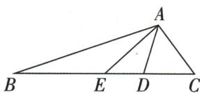

<!-- question-source:start -->
3[2025 福建泉州期中, 中]如图, 在 $\triangle ABC (AB > AC)$ 中, $AD, AE$ 分别为 $\triangle ABC$ 的角平分线、中线, 若 $7AB = 13AC$ , $ED = kDC$ , 则 $k$ 的值为 \_\_\_\_.

<!-- question-source:end -->

![[Q00104172A1]]
