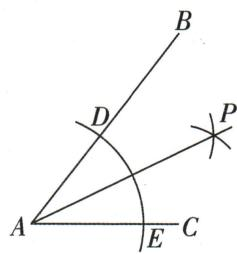
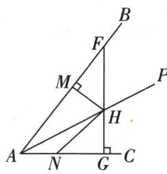

<!-- question-source:start -->
4[2025吉林松原质检,中]如图(1),以∠BAC的顶点A为圆心,适当长为半径画弧,交AB于点D,交AC于点E,分别以点D,E为圆心,大于 $\frac{1}{2}DE$ 的长为半径画弧,两弧在∠BAC的内部相交于点P,画射线AP.

(1)根据以上尺规作图的过程可以得到的关于射线 $AP$ 的结论是\_\_\_\_.

(2) 在图(1)中射线 $AB$ 上取一点 $F$ , 过点 $F$ 作 $FG \perp AC$ 于点 $G$ , 交射线 $AP$ 于点 $H$ , 过点 $H$ 作

$HM \perp AB$ 于点 M, 在 AC 上取一点 N, 使 NH = FH, 如图(2)所示. 求证: MF = GN.

(3)在(2)的条件下,若 $\triangle AGH$ 的面积等于5,则四边形AFHN的面积等于\_\_\_\_.

图(1)

图(2)
<!-- question-source:end -->

![[Q00104173A1]]
