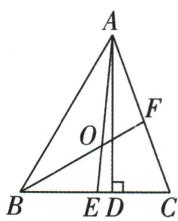
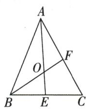
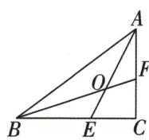

<!-- question-source:start -->
5 思想方法 数形结合 [较难] 在 $\triangle ABC$ 中, $AE, BF$ 是角平分线, 交于 $O$ 点. (1) 如图(1), $AD$ 是高, $\angle BAC = 50^{\circ}, \angle C = 70^{\circ}$ , 求 $\angle DAC$ 和 $\angle BOA$ 的度数. (2) 如图(2), 若 $OE = OF, AC \neq BC$ , 求 $\angle C$ 的度数. (3) 如图(3), 若 $\angle C = 90^{\circ}, BC = 8, AC = 6, AB = 10$ , 求 $S_{\triangle AOB}$ .

图(1)
图(2)

图(3)
<!-- question-source:end -->

![[Q00104174A1]]
