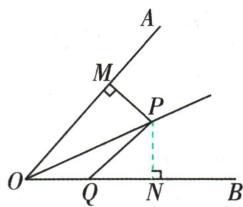

> [!success]- 必刷题
>
> > [!success] **【答案】** B
>
> > [!note]- **【解析】**
> > 如图, OP 平分 $\angle AOB, PM = 6, PM \perp OA$ , 过点 P 作 $PN \perp OB$ 于 N, 则 PM = PN = 6.
> > ∵ 点 Q 是 OB 边上的任意一点, ∴ $PQ \geqslant 6$ . 故选 B
> >
> > 
