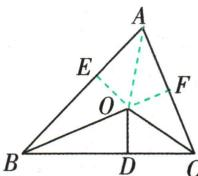

> [!success]- 必刷题
>
> > [!success] **【答案】** D
>
> > [!note]- **【解析】**
> > 如图, 过点 O 作 $OE \perp AB$ 于 E,
> >
> > $OF \perp AC$ 于 F，连接 OA.
> > ∵ BO, CO 分别平分 ∠ABC
> > 和 ∠ACB, OD ⊥ BC, ∴ OE =
> > OD, OD = OF, 即 OE = OF =
> > OD = 4, ∴ △ABC 的面积为 $S_{\triangle AOB} + S_{\triangle AOC} + S_{\triangle OBC} = \frac{1}{2} \times AB \times OE + \frac{1}{2} \times AC \times OF + \frac{1}{2} \times BC \times OD = \frac{1}{2} \times 4 \times (AB + AC + BC) = \frac{1}{2} \times 4 \times 34 = 68.$ 故选 D.
> >
> > 
