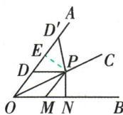

> [!success]- 必刷题
>
> > [!success] **【答案】** D
>
> > [!note]- **【解析】**
> > 根据作图方法可得点 P 在第二象限的角平分线上, ∴ 点 P 到 x 轴、y 轴的距离相等, ∴ a = -b, ∴ $a + b = 0$ , 故选 D.
> >
> > 6.3或7 【解析】如图, 过点 P 作 $PE \perp OA$ 于点 E. ∵ OC 平分 $\angle AOB, PE \perp OA, PN \perp OB,$ ∴ PE = PN. ∵ OP = OP,
> >
> > 
> >
> > $\therefore \mathrm{Rt}\triangle OPE\cong \mathrm{Rt}\triangle OPN(\mathrm{HL}),\therefore OE = ON = 5.$ $\because OM = 3,ON = 5,\therefore MN = 2.$ 若点 $D$ 在线段 $OE$ 上， $\because PM = PD,PE = PN,\therefore \mathrm{Rt}\triangle PMN\cong$ $\mathrm{Rt}\triangle PDE(\mathrm{HL}),\therefore DE = MN = 2,\therefore OD = OE-$ $DE = 3.$ 若点 $D^{\prime}$ 在射线 $EA$ 上，同理可得 $D^{\prime}E=$ $MN = 2,\therefore OD^{\prime} = OE + D^{\prime}E = 7.$ 故答案为3或7.
