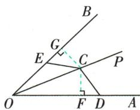

> [!success]- 必刷题
>
> > [!success] **【答案】** 详见解析
>
> > [!note]- **【解析】**
> > 【证明】如图,过点 C 作 $CF \perp OA$ 于点 F, $CG \perp OB$ 于点 G, 则 $\angle OFC = \angle OGC = 90^{\circ}$ .
> >
> > 
> >
> > $\because \angle OFC + \angle OGC + \angle FOG + \angle FCG = 360^{\circ},$ $\therefore \angle FOG + \angle FCG = 180^{\circ}.\because \angle DCE = 180^{\circ} - \alpha ,$ 初中必刷题 数字八年级上册 RJ $\angle AOB = \alpha, \therefore \angle DCE + \angle AOB = 180^{\circ},$ $\therefore \angle FCG = \angle DCE,$ 即 $\angle FCE + \angle ECG =$ $\angle FCE + \angle DCF, \therefore \angle ECG = \angle DCF.$ 又∵ OP 为 $\angle AOB$ 的平分线, $CF \perp OA, CG \perp OB, \therefore CF =$ $CG, \therefore \triangle CEG \cong \triangle CDF(ASA), \therefore CD = CE.$
