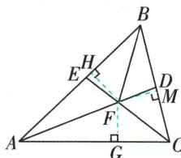

> [!success]- 必刷题
>
> > [!success] **【答案】** C
>
> > [!note]- **【解析】**
> > 如图, 过点 F 作 $FG \perp AC$ , $FH \perp$
> >
> > $AB, FM \perp BC.\because AD, CE$ 分别是 $\angle BAC, \angle BCA$ 的平分线， $\therefore FG = FH, FG = FM, \therefore FH = FM, \therefore BF$ 平分 $\angle ABC$ ，故丙说法正确.
> >
> > 
> >
> > $S_{\triangle ABC}=S_{\triangle ABF}+S_{\triangle ACF}+S_{\triangle BCF}=\frac{1}{2}AB\cdot FH+\frac{1}{2}AC\cdot FG+\frac{1}{2}BC\cdot FM=\frac{1}{2}(AB+AC+BC)\cdot FG=42.$ ∵ $\triangle ABC$ 的周长为 21, ∴ $AB+BC+AC=21$ , ∴ FG=4, ∴ 点 F 到 AC 的距离为 4, 故乙说法错误. 条件不足, 无法得到 FE=FD, 故甲说法错误.
> >
> > 故选 **C**.
