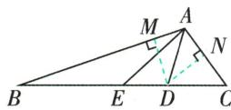

> [!success]- 必刷题
>
> > [!success] **【答案】** $\frac{3}{7}$
>
> > [!note]- **【解析】**
> > 如图, 过点 $D$ 作 $DM \perp AB$ 于点 $M$ ,
> >
> > $$
> > D N \perp A C
> > $$
> >
> > $$
> > \angle B A C
> > $$
> >
> > $$
> > N. \because A D
> > $$
> >
> > $$
> > \therefore D M = D N.
> > $$
> >
> > 
> >
> > $BC$ 的距离为 $h$ ，则 $\frac{S_{\triangle ABD}}{S_{\triangle ADC}} = \frac{\frac{1}{2}AB\cdot DM}{\frac{1}{2}AC\cdot DN} =$ $\frac{\frac{1}{2}BD\cdot h}{\frac{1}{2}DC\cdot h},\therefore \frac{AB}{AC} = \frac{BD}{DC}.\because 7AB = 13AC,\therefore \frac{AB}{AC} =$ $\frac{13}{7},\therefore \frac{BD}{DC} = \frac{13}{7}$ 即 $BD = \frac{13}{7} CD,\therefore CD = \frac{7}{20} BC.$ $\because AE$ 为 $\triangle ABC$ 的中线，∴ $BE = EC = \frac{1}{2} BC,$
> >
> > (1) 根据垂直的定义得到 $\angle ADC = 90^{\circ}$ ，进而得到 $\angle DAC$ 。根据角平分线的定义得到 $\angle BAO$ 的度数，再根据三角形的内角和定理及角平分线的定义得到 $\angle ABO$ 的度数，即可得到 $\angle BOA$ 的度数；
> > (2) 连接 OC，过点 O 作 $OM \perp BC, ON \perp AC$ ，根据角平分线的性质得到 OM = ON，证明 $Rt\triangle OEM \cong Rt\triangle OFN$ ，根据全等三角形的性质得到 $\angle EOM = \angle FON$ ，进而利用角的和差可得答案；
> > (3) 过 O 作 $OD \perp AB$ 于 D, $OG \perp BC$ 于 G, $OH \perp AC$ 于 H，根据角平分线的性质得到 $OD = OG = OH$ ，再根据三角形的面积公式即可得答案.
> >
> > $\therefore DE = EC - CD = \frac{3}{20} BC.\because ED = kDC,\therefore k = \frac{DE}{DC} = \frac{3}{7}.$ 故答案为 $\frac{3}{7}$
