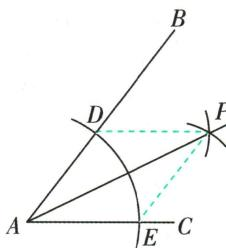

> [!success]- 必刷题
>
> > [!success] **【答案】** $AP$ 平分 $\angle BAC$
>
> > [!note]- **【解析】**
> > 
> > 【证明】由(1)得 $AP$ 平分 $\angle BAC$ . $\because HM \perp AB, HG \perp AC, \therefore HM = HG, \angle HMF = \angle HGN = 90^\circ$ . 在 Rt $\triangle HMF$ 和 Rt $\triangle HGN$ 中， $\left\{ \begin{array}{l} FH = NH, \\ HM = HG, \end{array} \right.$ $\therefore \mathrm{Rt}\triangle HMF \cong \mathrm{Rt}\triangle HGN(\mathrm{HL}), \therefore MF = GN$ . (3)【解】由(2)得 $HM = HG, \angle HMA = \angle HGA = 90^\circ$ , Rt $\triangle HMF \cong \mathrm{Rt}\triangle HGN, \therefore S_{\mathrm{Rt}\triangle HMF} = S_{\mathrm{Rt}\triangle HGN}$ . 在 Rt $\triangle HMA$ 和 Rt $\triangle HGA$ 中， $\left\{ \begin{array}{l} AH = AH, \\ HM = HG, \end{array} \right.$ $\therefore \mathrm{Rt}\triangle HMA \cong \mathrm{Rt}\triangle HGA(\mathrm{HL}), \therefore S_{\mathrm{Rt}\triangle HMA} = S_{\mathrm{Rt}\triangle HGA}, \therefore S_{\text{四边形}AFHN} = S_{\mathrm{Rt}\triangle HMF} + S_{\mathrm{Rt}\triangle HMA} + S_{\triangle HNA} = S_{\mathrm{Rt}\triangle HGN} + S_{\mathrm{Rt}\triangle HMA} + S_{\triangle HNA} = 2S_{\triangle AGH} = 10.$ 故答案为 10.
> >
> > ## 刷素养·
