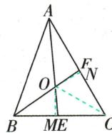
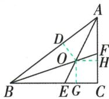

> [!success]- 必刷题
>
> > [!success] **【答案】** 详见解析
>
> > [!note]- **【解析】**
> > 【解】(1)∵AD⊥BC,∴∠ADC=90°.
> > ∵∠C=70°,∴∠DAC=180°-90°-70°=20°.
> > ∵∠BAC=50°,∠C=70°,AE是∠BAC的平分线，∴∠BAO=25°，∠ABC=60°．∵BF是∠ABC的平分线，∴∠ABO=30°，∴∠BOA=180°-∠BAO-∠ABO=180°-25°-30°=125°.
> >
> > (2) 连接 OC, 如图(1). ∵ AE, BF 是角平分线, 且交于 O 点, ∴ 易知 CO 是 ∠ACB 的平分线, ∴ ∠OCF = ∠OCE. 过点 O 作 OM⊥BC, ON⊥AC, 则 OM = ON. 在 Rt△OEM 与 Rt△OFN
> >
> > 
> > 图(1)
> >
> > 中， $\left\{\begin{aligned}OE&=OF,\\ OM&=ON,\end{aligned}\right.$ $\therefore Rt\triangle OEM\cong Rt\triangle OFN(HL),$ $\therefore \angle EOM = \angle FON, \therefore \angle MON = \angle EOF = 180^{\circ}-$ $\angle ACB.\because AE,BF$ 是角平分线， $\therefore$ 易得 $\angle AOB = 90^{\circ} + \frac{1}{2}\angle ACB.$ 又 $\because \angle AOB = \angle EOF,\therefore 90^{\circ}+$ $\frac{1}{2}\angle ACB = 180^{\circ} - \angle ACB,\therefore \angle ACB = 60^{\circ}.$
> >
> > (3) 如图 (2), 过点 $O$ 作 $OD \perp AB$ 于 $D, OG \perp BC$ 于 $G, OH \perp AC$ 于 $H$ . $\because AE, BF$ 是角平分线, 且交于 $O$ 点, $\therefore OD = OG = OH$ ,
> >
> > 
> > 图(2)
> >
> > $\therefore S_{\triangle ABC} = \frac{1}{2}\times 8\times 6 = \frac{1}{2}\times 10\times OD + \frac{1}{2}\times 8\times OG+$ $\frac{1}{2}\times 6\times OH,\therefore OD = 2,\therefore S_{\triangle AOB} = \frac{1}{2}\times 10\times 2 = 10.$
