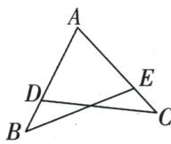

<!-- question-source:start -->
2[2024 北京朝阳区期末]如图, $AB = AC$ , 下列条件: ① $\angle B = \angle C$ ; ② $\angle AEB = \angle ADC$ ; ③ $AE = AD$ ; ④ $BE = CD$ 中, 若只添加一

个条件就可以证明 $\triangle ABE \cong \triangle ACD$ ，则所有符合的条件序号是 \_\_\_\_.
<!-- question-source:end -->

![[Q00104116A1]]
