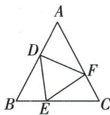
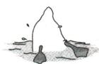

<!-- question-source:start -->
3[2024 江苏淮安期中]如图, $\triangle ABC$ 中,AB=AC,动点D,E,F分别在AB,BC,AC上移动,移动过程中始终保持BD=CE, $\angle DEF=\angle B$ ,请你判断是否存在始终与 $\triangle BDE$ 全等的三角形,并说明理由.

<!-- question-source:end -->

![[Q00104117A1]]
