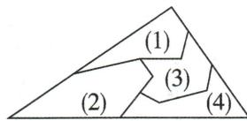

<!-- question-source:start -->
4[2025 山东德州期中]一名工作人员不慎将一

块三角形模具打碎成了如图所示的四块,他需要去商店再配一块与之大

小和形状完全相同的模具. 现只能拿两块去配, 其中可以配出符合要求的模具的是 ( )
A.(1)和(3) B.(3)和(4)
C.(1)和(4) D.(1)和(2)
<!-- question-source:end -->

![[Q00104118A1]]
