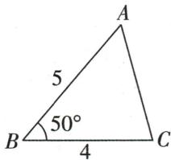
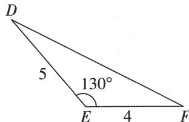

<!-- question-source:start -->
5 新考法 [2025 北京海淀区期中] 数学活动课上, 小敏、小颖分别画了 $\triangle ABC$ 和 $\triangle DEF$ , 其尺寸如图, 如果把 $\triangle ABC$ 的面积记作 $p$ , $\triangle DEF$ 的面积记作 $q$ , 那么 $p$ 与 $q$ 的大小关系为 ( )

小敏画的三角形 小颖画的三角形
A. p > q B. p = q
C. p < q D. 不能确定
<!-- question-source:end -->

![[Q00104119A1]]
