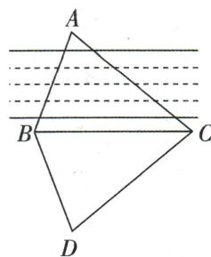

<!-- question-source:start -->
6[2025甘肃武威期末]如图,为了测量池塘两侧A,B之间的距离,选取点C(与B在池塘同侧),经测量 $\angle BAC=70^{\circ}$ ,然后在BC的一侧找到一点D,使得BC为 $\angle ABD$ 的平分线,且 $\angle BDC=70^{\circ}$ .若BD的长为8米,求池塘两侧A,B之间的距离.

<!-- question-source:end -->

![[Q00104120A1]]
