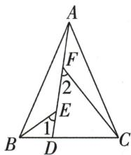

<!-- question-source:start -->
1[中]如图,在 $\triangle ABC$ 中, $AB=AC,AB>BC$ ,点 $D$ 在边 $BC$ 上, $CD=2BD$ ,点 $E,F$ 在线段 $AD$ 上, $\angle 1=\angle 2=\angle BAC$ ,若 $\triangle ABC$ 的面积为18,则 $\triangle ACF$ 与 $\triangle BDE$ 的面积之和是()

A. 6 B. 8 C. 9 D. 12
<!-- question-source:end -->

![[Q00104121A1]]
