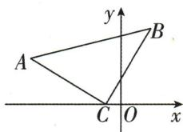
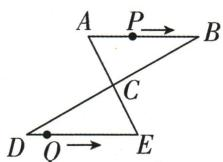

<!-- question-source:start -->
3[2024 湖北宜昌校级质检, 中] 如图, 在 $\triangle ABC$ 中, $\angle ACB = 90^{\circ}, AC = BC$ , 点 $A$ 的坐标为 $(-6, 3)$ , 点 $C$ 的坐标为 $(-1, 0)$ , 则点 $B$ 的坐标是 \_\_\_\_.

(第3题图)

(第4题图)
<!-- question-source:end -->

![[Q00104123A1]]
