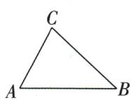
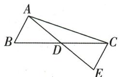
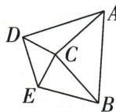

<!-- question-source:start -->

## 5 核心素养推理能力 [2024 陕西渭南期末,较难] 问题提出:

(1) 我们把两个面积相等但不全等的三角形叫作偏等积三角形. 如图(1), $\triangle ABC$ 中, $AC = 8$ , $BC = 9$ , $AB = 10$ , $P$ 为 $AC$ 上一点, 当 $AP =$ \_\_\_\_时, $\triangle ABP$ 与 $\triangle CBP$ 是偏等积三角形. 问题探究:

(2)如图(2), $\triangle ABD$ 与 $\triangle ACD$ 是偏等积三角形, $AB = 2, AC = 6$ , 且线段 $AD$ 的长度为正整数, 过点 $C$ 作 $CE \parallel AB$ 交 $AD$ 的延长线于点 $E$ , 则 $AD$ 的长为 \_\_\_\_. 问题解决:

(3) 如图(3), C 为四边形 ABED 内的一点, CA = CB, CD = CE, $\angle ACB = \angle DCE = 90^{\circ} (0^{\circ} < \angle BCE < 90^{\circ})$ . $\triangle ACD$ 与 $\triangle BCE$ 是偏等积三角形吗? 请说明理由.

图(1)
图(2)

图(3)
<!-- question-source:end -->

![[Q00104125A1]]
