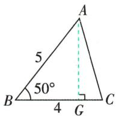
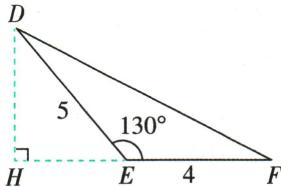

> [!success]- 必刷题
>
> > [!success] **【答案】** B
>
> > [!note]- **【解析】**
> > 如图(1)，过点 A 作 $AG \perp BC$ 于点 G，如图(2)，过点 D 作 $DH \perp FE$ 交 FE 的延长线于点 H，则 $\angle DEH = 180^{\circ} - 130^{\circ} = 50^{\circ}$ . 在 $\triangle ABG$ 和 $\triangle DEH$ 中， $\left\{\begin{aligned}\angle AGB&=\angle DHE=90^{\circ},\\ \angle ABG&=\angle DEH=50^{\circ},\\ AB&=DE=5,\end{aligned}\right.$ ∴ $\triangle ABG \cong \triangle DEH(AAS)$ , ∴ AG = DH. ∵ BC =
> > EF = 4, ∴ $\frac{1}{2} \times BC \times AG = \frac{1}{2} \times EF \times DH$ , ∴ $S_{\triangle ABC} =$
> >
> > 
> > 图(1)
> >
> > 
> > 图(2)
