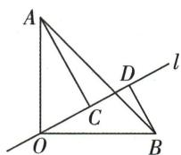
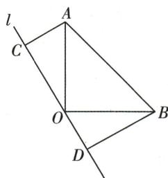

> [!success]- 必刷题
>
> > [!success] **【答案】** B
>
> > [!note]- **【解析】**
> > 如图（1），∵ $AC \perp l, BD \perp l,$ ∴ $\angle ACO = \angle ODB = 90^{\circ}, \therefore \angle OAC + \angle AOC = 90^{\circ}.$ $\because \angle AOB = 90^{\circ}, \therefore \angle AOC + \angle BOD = 90^{\circ},$ $\therefore \angle OAC = \angle BOD.$ 在 $\triangle ACO$ 和 $\triangle ODB$ 中， $\left\{\begin{aligned}\angle ACO &= \angle ODB, \\ \angle OAC &= \angle BOD, \\ OA &= BO,\end{aligned}\right.$ ∴ AC = OD, OC = BD, ∴ DC = OD - OC = AC - BD,
> > 故甲不正确.
> >
> > 
> >
> > 
> > 图(1)
> > 图(2)
> >
> > 如图（2），∵ $AC \perp l, BD \perp l, \therefore \angle ACO = \angle ODB = 90^{\circ}, \therefore \angle OAC + \angle AOC = 90^{\circ}.$
> >
> > 初中必刷题 数学八年级上册 RJ
> > ∵ $\angle AOB = 90^{\circ}$ , ∴ $\angle AOC + \angle BOD = 90^{\circ}$ ,
> > ∴ $\angle OAC = \angle BOD$ . 在 $\triangle ACO$ 和 $\triangle ODB$ 中， $\left\{\begin{aligned}\angle ACO &=\angle ODB,\\ \angle OAC &=\angle BOD,\\ \triangle ACO &\cong\triangle ODB(AAS),\\ OA&=OB,\end{aligned}\right.$ ∴ AC = OD, OC = BD, ∴ DC = OD + OC = AC + BD,
> > 故乙正确.
> >
> > 故选 **B**.
