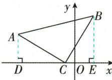
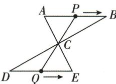

> [!success]- 必刷题
>
> > [!success] **【答案】** $(2,5)$
>
> > [!note]- **【解析】**
> > 作 $AD \perp x$ 轴于点 $D, BE \perp x$ 轴▶思路分析
> >
> > 于点 E，如图所示，则 $\angle ADC = \angle CEB = 90^{\circ}$ , $\therefore \angle ACD + \angle CAD = 90^{\circ}.$ $\because \angle ACB = 90^{\circ}, \therefore \angle ACD +$
> >
> > 
> >
> > $\angle BCE = 90^{\circ}, \therefore \angle CAD = \angle BCE.$ 在 $\triangle ACD$ 和 $\triangle CBE$ 中， $\left\{ \begin{array}{l} \angle ADC = \angle CEB, \\ \angle CAD = \angle BCE, \\ AC = CB, \end{array} \right.$ $\therefore \triangle ACD \cong \triangle CBE(AAS), \therefore AD = CE, DC = EB.$ $\because$ 点 $A$ 的坐标为 $(-6,3)$ ，点 $C$ 的坐标为 $(-1,0)$ ， $\therefore OD = 6, AD = 3, OC = 1, \therefore CE = 3, BE = OD - OC = 6 - 1 = 5, \therefore OE = CE - OC = 3 - 1 = 2, \therefore$ 点 $B$ 的坐标为 $(2,5)$ . 故答案为 $(2,5)$ .
> >
> > 4.1 或 2 【解析】如图, 在 $\triangle ABC$ 和 $\triangle EDC$ 中,
> >
> > 
> >
> > $\left\{ \begin{array}{l} AC = EC, \\ \angle ACB = \angle ECD, \\ BC = DC, \end{array} \right.$ $\therefore \triangle ABC \cong \triangle EDC(SAS)$ , $DQ \rightarrow E$ $\therefore \angle A = \angle E, ED = AB = 4cm.$ 在 $\triangle ACP$ 和 $\triangle ECQ$ 中， $\left\{ \begin{array}{l} \angle A = \angle E, \\ AC = CE, \\ \angle ACP = \angle ECQ, \end{array} \right.$ $\therefore \triangle ACP \cong \triangle ECQ(ASA), \therefore AP = EQ.$ 当 $0 \leqslant t \leqslant \frac{4}{3}$ 时， $3t = 4-t$ ，解得 $t = 1$ ；当 $\frac{4}{3} < t \leqslant \frac{8}{3}$ 时， $8-3t = 4-t$ ，解得 $t = 2.$ 综上所述，当线段 $PQ$ 经过点 $C$ 时， $t$ 的值为1或2.故答案为1或2.
> >
> > ## 刷素养·
