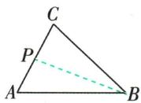
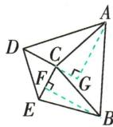

> [!success]- 必刷题
>
> > [!success] **【答案】** 4
>
> > [!note]- **【解析】**
> > 【解】(1)如图(1),取AC中点P,连接BP.
> > ∵△ABP与△CBP在AP,CP边上的高相等,
> > ∴当 $AP=CP=\frac{1}{2}AC=\frac{1}{2}\times8=4$ 时,△ABP与
> > △CBP面积相等.∵BC=9,AB=10,∴BC≠
> > AB.∵AP=CP,BP=BP,BC≠AB,∴△ABP与
> > △CBP不全等,∴当AP=4时,△ABP与
> >
> > 先证明 $\triangle ACD \cong \triangle CBE$ ，得到 $AD = CE, DC = EB$ ，然后再根据点 $A$ 的坐标为 $(-6, 3)$ ，点 $C$ 的坐标为 $(-1, 0)$ 得到 $OD, AD, OC$ 的长，进而推出点 $B$ 的坐标.
> >
> > ## 思路分析
> >
> > （3）先通过 $\angle ACD \neq \angle BCE, CA = CB, CD = CE$ 说明 $\triangle ACD$ 与 $\triangle BCE$ 不全等，再作 $BF \perp CE$ 于点 $F, AG \perp DC$ 交 $DC$ 的延长线于点 $G$ , 证得 $\triangle ACG \cong \triangle BCF$ , 得 $AG = BF$ , 即可证得 $\triangle ACD$ 与 $\triangle BCE$ 面积相等, 从而证明 $\triangle ACD$ 与 $\triangle BCE$ 是偏等积三角形.
> >
> > $\triangle CBP$ 是偏等积三角形,故答案为4.
> >
> > 
> > 图(1)
> >
> > 
> > 图(2)
> >
> > (2)∵△ABD与△ACD是偏等积三角形，且△ABD与△ACD在BD,CD边上的高相等，∴BD=CD.∵CE∥AB,∴∠E=∠BAD.在
> > △ECD和△ABD中， $\left\{\begin{aligned}\angle E&=\angle BAD,\\ \angle EDC&=\angle ADB,\\ CD&=BD,\end{aligned}\right.$ ∴△ECD≌△ABD(AAS)，∴ED=AD,EC=AB=2.∵AC-EC<AE<AC+EC，且AC=6,AE=2AD,∴6-2<2AD<6+2,∴2<AD<4.∵线段AD的长度为正整数，∴AD=3，故答案为3.
> > (3)△ACD与△BCE是偏等积三角形.理由：
> > ∵∠ACB=∠DCE=90°,∴∠ACD+∠BCE=180°.∵0°<∠BCE<90°,∴∠ACD>90°,
> > ∴∠ACD≠∠BCE.∵CA=CB,CD=CE,
> > ∴△ACD与△BCE不全等.如图(2)，作BF⊥CE于点F,AG⊥DC交DC的延长线于点G，
> > 则∠G=∠BFC=90°.∵∠ECG=180°-
> > ∠DCE=90°,∴∠ACG=∠BCF=90°-∠BCG.
> > 在△ACG和△BCF中， $\left\{\begin{aligned}\angle G&=\angle BFC,\\ \angle ACG&=\angle BCF,\\ CA&=CB,\end{aligned}\right.$ ∴△ACG≌△BCF(AAS),∴AG=BF,∴ $\frac{1}{2}CD$ AG= $\frac{1}{2}$ CE·BF,∴△ACD与△BCE面积相等，∴△ACD与△BCE是偏等积三角形.
