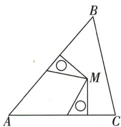

<!-- question-source:start -->
1[2025 安徽亳州期末]两个完全一样的三角板如图摆放,使三角板的一条直角边分别与 $\triangle ABC$ 的边 $AB, AC$ 重合,它们的顶点重合于点 $M$ ,则点 $M$ 一定在 ( )

A. $\angle A$ 的平分线上 B. $AC$ 边上的高上 C. $BC$ 边上的高上 D. $AB$ 边上的中线上
<!-- question-source:end -->

![[Q00104175A1]]
