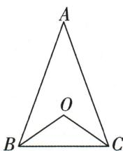

<!-- question-source:start -->
2[2025 江苏常州期中]如图, 点 O 在 $\triangle ABC$ 内, 且到三边的距离相等, 连接 OB, OC, 若 $\angle BOC = 110^{\circ}$ , 则 $\angle A$ 的大小是 ( )

A. $35^{\circ}$ B. $40^{\circ}$ C. $45^{\circ}$ D. $70^{\circ}$
<!-- question-source:end -->

![[Q00104176A1]]
