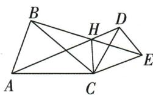

<!-- question-source:start -->
5[2025 山东日照调研]如图,在 $\triangle ACB$ 和 $\triangle DCE$ 中, $CA=CB;CD=CE,\angle ACB=\angle DCE=40^{\circ},AD,BE$ 交于点 $H$ ,连接 $CH$ .

(1) 求证: $\triangle ACD \cong \triangle BCE$ ; (2) 求证: $HC$ 平分 $\angle AHE$ .

<!-- question-source:end -->

![[Q00104179A1]]
