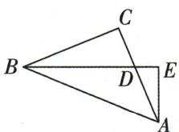
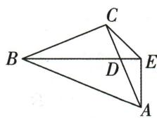

<!-- question-source:start -->
6[2025 内蒙古鄂尔多斯期中]如图,已知等腰直角 $\triangle ABC$ 中, $\angle ACB = 90^{\circ}$ , $AC = BC$ , 点 $D$ 是腰 $AC$ 上的一点(不与 $A, C$ 重合), 连接 $BD$ , 过点 $A$ 作 $AE \perp BD$ , 交 $BD$ 的延长线于点 $E$ .

(1) 如图(1), 若 $BD$ 是 $\angle ABC$ 的平分线, 求证: $BD = 2AE$ .

(2) 如图(2), 连接 $CE$ , 当点 $D$ 在线段 $AC$ 上运动时(不与 $A, C$ 重合), $\angle BEC$ 的大小是否发生变化? 若改变, 求出它的最大值; 若不改变, 求出这个定值.

图(1)

图(2)
<!-- question-source:end -->

![[Q00104180A1]]
