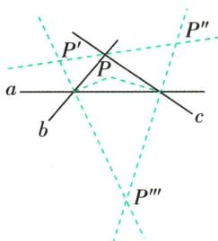

> [!success]- 必刷题
>
> > [!success] **【答案】** B
>
> > [!note]- **【解析】**
> > ∵ $\angle BOC = 110^{\circ}$ , ∴ $\angle OBC + \angle OCB = 180^{\circ} - 110^{\circ} = 70^{\circ}$ . ∵ 点 O 在 $\triangle ABC$ 内, 且到三边的距离相等, ∴ OB 平分 $\angle ABC$ , OC 平分 $\angle ACB$ , ∴ $\angle ABC = 2\angle OBC$ , $\angle ACB = 2\angle OCB$ , ∴ $\angle ABC + \angle ACB = 2(\angle OBC + \angle OCB) = 140^{\circ}$ , ∴ $\angle A = 180^{\circ} - (\angle ABC + \angle ACB) = 180^{\circ} - 140^{\circ} = 40^{\circ}$ . 故选 B.
> >
> > 3.4 【解析】∵ 点 P 到三条直线的距离相等，
> > ∴ 点 P 是三条直线 a, b, c 所形成的角的平分线的交点，如图所示，图中点 P，点 $P'$ ，点 $P''$ ，点 $P'''$ 即为所求，故答案为 4.
> >
> > 思路分析
> > (2) 过点 C 作 $CM \perp BD$ 于点 M, $CN \perp AE$ , 交 AE 的延长线于点 N, 结合 (1) 利用 AAS 证明 $\triangle BCM \cong \triangle ACN$ , 得 CM = CN, 根据角平分线的判定定理得 EC 是 $\angle BEN$ 的平分线, 进而可得 $\angle BEC = 45^{\circ}$ , 即可得出结论.
> >
> > 
