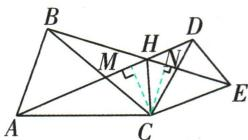

> [!success]- 必刷题
>
> > [!success] **【答案】** D
>
> > [!note]- **【解析】**
> > 【证明】(1)∵∠ACB=∠DCE,
> > ∴∠ACD=∠BCE.
> > 在△ACD和△BCE中, $\left\{\begin{aligned}CA&=BC,\\ \angle ACD&=\angle BCE,\\ CD&=CE,\end{aligned}\right.$ ∴ $\triangle ACD \cong \triangle BCE(SAS)$ .
> > (2)如图,过点 C 作 CM⊥AD 于 M, CN⊥BE 于 N. ∵ $\triangle ACD \cong \triangle BCE$ , ∴ $\angle CAM = \angle CBN$ . 在 $\triangle ACM$ 和 $\triangle BCN$ 中, $\left\{\begin{aligned}\angle AMC &= \angle BNC = 90^{\circ}, \\ \angle CAM &= \angle CBN, \\ AC &= BC,\end{aligned}\right.$ ∴ $\triangle ACM \cong \triangle BCN (AAS)$ , ∴ CM = CN. 又
> > ∵ $CM \perp AD, CN \perp BE, \therefore HC$ 平分 $\angle AHE$ .
> >
> > 
