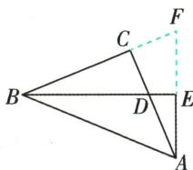
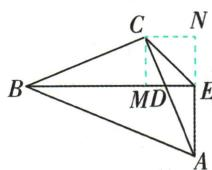

> [!success]- 必刷题
>
> > [!success] **【答案】** (1)
>
> > [!note]- **【解析】**
> > 【证明】如图(1),延长BC,AE,相交于点F.∵AE⊥BE,∴∠AEB=90°.∵∠ACB=90°=∠AEB,∠BDC=∠ADE,∴∠CBD=∠CAE.又∵BC=AC,∠BCD=∠ACF=90°,∴△BCD≌△ACF(ASA),∴BD=AF.∵BD是∠ABC的平分线,∴∠ABE=∠FBE.∵AE⊥BD,∴∠AEB=∠FEB=90°.又∵BE=BE,∴△ABE≌△FBE(ASA),∴AE=FE,∴AF=2AE,∴BD=2AE.
> >
> > 
> >
> > 
> > 图(1)
> > 图(2)
> >
> > (2)【解】 $\angle BEC$ 的大小不变. 如图(2), 过点 $C$ 作 $CM \perp BD$ 于点 $M, CN \perp AE$ , 交 $AE$ 的延长线于点 $N$ , 则 $\angle BMC = \angle ANC = 90^\circ$ . $\because AE \perp BD, \therefore \angle BEN = 90^\circ$ . 由(1)知 $\angle CBD = \angle CAE$ . 又 $\because AC = BC, \therefore \triangle BCM \cong \triangle ACN$ (AAS), $\therefore CM = CN, \therefore EC$ 是 $\angle BEN$ 的平分线, $\therefore \angle BEC = \frac{1}{2} \angle BEN = \frac{1}{2} \times 90^\circ = 45^\circ$ , 即 $\angle BEC$ 的大小不变, 为定值 $45^\circ$ .
