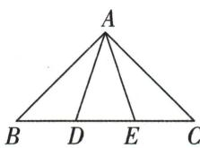

<!-- question-source:start -->
4[2025 福建厦门质检]如图所示,在 $\triangle ABC$ 中, $AB=AC,D,E$ 是边 $BC$ 的三等分点,且 $AD=AE$ . 求证: $\triangle ABD\cong\triangle ACE$ .

建议用时-20分钟 答案-D22
<!-- question-source:end -->

![[Q00104129A1]]
