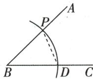
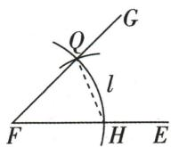

<!-- question-source:start -->
5[2025 浙江宁波期末]如图,已知∠ABC,以点B为圆心,适当长为半径作弧,分别交AB,BC于P,D;作一条射线FE,以点F为圆心,BD长为半径作弧l,交EF于点H;以点H为圆心,PD长为半径作弧,交弧l于点Q;过点Q作射线FG.这样可得∠GFE=∠ABC,根据上述操作可判定△PBD≌△QFH,其依据是()

A.SSS B.SAS C.ASA D.AAS
<!-- question-source:end -->

![[Q00104130A1]]
