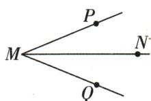

<!-- question-source:start -->
7[2024 河北邢台期中]如图, M 为比赛出发点, P, Q 两点为标志物, 且到 M 点的距离相等, 选手小明从 M 点出发, 计划沿 $\angle PMQ$ 的平分线骑摩托车行驶, 若小明沿射线 MN 行驶, 在 N 点处经红外线设备测得他到标志物 P, Q 两点的距离相等, 判断小明的行驶路线是否偏离预定路线, 并说明理由.

<!-- question-source:end -->

![[Q00104132A1]]
