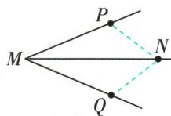

> [!success]- 必刷题
>
> > [!success] **【答案】** 详见解析
>
> > [!note]- **【解析】**
> > 【解】小明的行驶路线没有偏离预定路线. 理由: 如图, 连接 PN, QN. 由题意得 PN = QN, PM = QM. 又
> >
> > 
> >
> > ∵ MN=MN, ∴ $\triangle PMN \cong \triangle QMN$ , ∴ $\angle PMN = \angle QMN$ , ∴ MN 是 $\angle PMQ$ 的平分线, ∴ 小明的行驶路线没有偏离预定路线.
