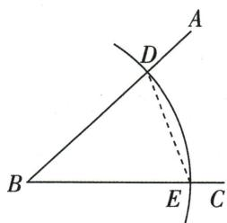
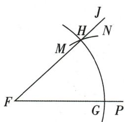

<!-- question-source:start -->
1[2025 浙江温州期中]如图,用尺规作 $\angle HFG = \angle ABC$ ,作图痕迹中弧 MN 是 ( )

A. 以点 $F$ 为圆心, $BE$ 长为半径的弧
B. 以点 $F$ 为圆心, $DE$ 长为半径的弧
C. 以点 $G$ 为圆心, $BE$ 长为半径的弧
D. 以点 $G$ 为圆心, $DE$ 长为半径的弧
<!-- question-source:end -->

![[Q00104133A1]]
