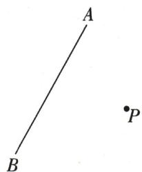
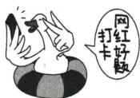

<!-- question-source:start -->
4[2025 辽宁大连质检]如图,已知直线 AB 及直线外一点 P.

(1)请你用一个圆规和一把没有刻度的直尺, 过点 $P$ 作直线 $CD$ , 使得 $CD \parallel AB$ . (保留作图痕迹, 不写作法)

(2) 在 (1) 中, $CD \parallel AB$ 的依据是 \_\_\_\_.
<!-- question-source:end -->

![[Q00104136A1]]
