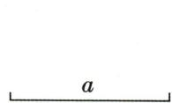
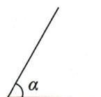

<!-- question-source:start -->
6[2025 福建南平质检]如图,已知线段 a 和 $\angle\alpha$ . 求作 $\triangle ABC$ , 使 AB = AC = a, $\angle A = \angle\alpha$ . (尺规作图,保留作图痕迹,不写作法)

<!-- question-source:end -->

![[Q00104138A1]]
