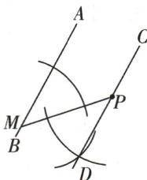

> [!success]- 必刷题
>
> > [!success] **【答案】** 内错角相等, 两直线平行
>
> > [!note]- **【解析】**
> > 【解】(1)如图,直线 CD 即为所求.(作法不唯一)
> > (2) 由作图可知 $\angle MPD = \angle AMP, \therefore CD \parallel AB$ , 故答案为内错角相等, 两直线平行.
> > (答案不唯一,需与(1)对应)
> >
> > 
