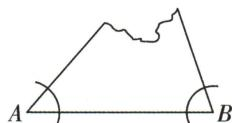
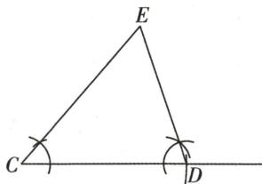

> [!success]- 必刷题
>
> > [!success] **【答案】** 详见解析
>
> > [!note]- **【解析】**
> > 【解】如图所示, $\triangle CDE$ 即为所求.
> >
> > 
> >
> > 
> >
> > $\because CD = AB, \angle ECD = \angle A, \angle EDC = \angle B,$ $\therefore \triangle CDE$ 是和原三角形全等的三角形,作图依据是 ASA.
> >
> > 课时 5 斜边及一直角边证全等(HL)
