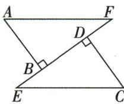

<!-- question-source:start -->
2[2025 辽宁大连期中]如图, $AB \perp EF$ 于点 $B, CD \perp EF$ 于点 $D, BE = DF$ . 若要直接用 “HL” 判定 Rt $\triangle ABF \cong$ Rt $\triangle CDE$ , 则需要添加的条件为

Rt△CDE,则需要添加的条件为\_\_\_\_.
<!-- question-source:end -->

![[Q00104141A1]]
