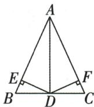

<!-- question-source:start -->
3[2024 河南濮阳调研]如图,在 $\triangle ABC$ 中, $AB=AC,D$ 为 $BC$ 上一点, $DE\perp AB,DF\perp AC$ ,垂足分别为 $E,F$ ,且 $DE=DF$ .请选择一对你认为全等的三角形并加以证明.

<!-- question-source:end -->

![[Q00104142A1]]
