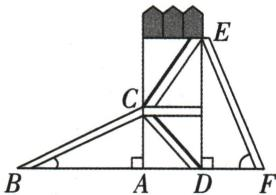

<!-- question-source:start -->
4 如图,有两个长度相同的滑梯,左边滑梯的高度 AC 与右边滑梯水平方向的长度 DF 相等,两个滑梯的倾斜角 $\angle ABC$ 和 $\angle DFE$ 之间的关系是 ()

A. $\angle ABC = \angle DFE$ B. $\angle ABC > \angle DFE$ C. $\angle ABC + \angle DFE = 100^{\circ}$ D. $\angle ABC + \angle DFE = 90^{\circ}$

<!-- question-source:end -->

![[Q00104143A1]]
