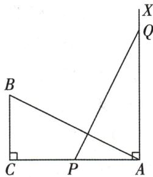

<!-- question-source:start -->
5[2025黑龙江哈尔滨期末]如图, $AC\perp BC$ 于点C,AC=6,BC=3,连接AB,射线 $AX\perp AC$ 于点A,

点 P 在线段 AC 上移动，
点 Q 在射线 AX 上随着点
P 移动,且始终保持 PQ=AB, 当 AP=\_\_\_\_时,
才能使 $\triangle PQA$ 与 $\triangle ABC$ 全等.

<!-- question-source:end -->

![[Q00104144A1]]
