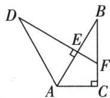

<!-- question-source:start -->
6[2024 湖北襄阳期中]如图, 在 $\triangle ABC$ 中, $\angle ACB = 90^{\circ}$ . 点 $D$ 在 $\triangle ABC$ 外, 连接 $AD$ , 作 $DE \perp AB$ 于点 $E$ , 延长 $DE$ 交 $BC$ 于点 $F$ , $AD = AB$ , $AE = AC$ .

(1) 求证: $DE = BC$ ;

(2) 若 $BF = 2, CF = 1$ , 求 $DF$ 的长.

<!-- question-source:end -->

![[Q00104145A1]]
