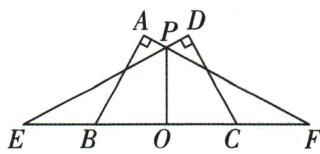

<!-- question-source:start -->
7 如图, $\angle A = \angle D = 90^{\circ}, AB = DC$ , 点 $E, F$ 在直线 $BC$ 上, 且 $BE = CF$ .

(1) 求证: $\angle E = \angle F$ ;

(2) 若 $PO$ 平分 $\angle EPF$ , 则 $PO$ 与 $BC$ 有什么位置关系? 并说明理由.

<!-- question-source:end -->

![[Q00104146A1]]
