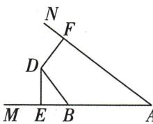

<!-- question-source:start -->
3 [2024 甘肃庆阳校级期中, 中] 如图, D 是 $\angle MAN$ 内部一点, $DE \perp AM$ 于 E, $DF \perp AN$ 于 F, 且 DE = DF, 点 B 是

射线 AM 上一点, AB = 6, BE = 2, 在射线 AN 上取一点 C, 使得 DC = DB, 则 AC 的长为 \_\_\_\_.
<!-- question-source:end -->

![[Q00104149A1]]
