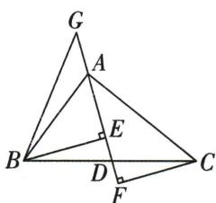

<!-- question-source:start -->
4 [中] 如图, $AD$ 是 $\triangle ABC$ 的中线, $BE \perp AD$ , 垂足为 $E, CF \perp AD$ , 交 $AD$ 的延长线于点 $F, G$ 是 $DA$ 延长线上一点, 连接 $BG$ .

(1) 求证: BE = CF;

(2) 若 BG = CA，求证：GA = 2DE。

<!-- question-source:end -->

![[Q00104150A1]]
