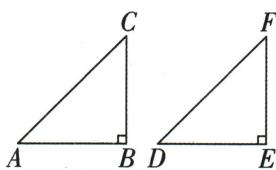
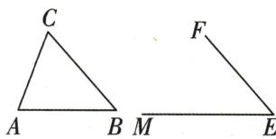
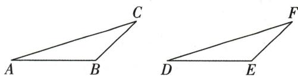

<!-- question-source:start -->
5 核心素养推理能力 [2025 广西崇左质检, 较难]
【阅读材料】学习了三角形全等的判定方法后,聪聪同学继续对“两个三角形的两边和其中一边的对角对应相等”的情形进行研究.
聪聪将其用符号语言表示: 在 $\triangle ABC$ 和 $\triangle DEF$ 中, AC = DF, BC = EF, $\angle B = \angle E$ .
【分类讨论】聪聪想:要想解决问题,应该对∠B进行分类研究.将∠B分为“直角、钝角、锐角”三种情况进行探究.

(1) 如图(1), 当 $\angle B$ 是直角时, 在 $\triangle ABC$ 和 $\triangle DEF$ 中, $AC = DF$ , $BC = EF$ , $\angle B = \angle E = 90^\circ$ , 则 Rt $\triangle ABC \cong$ Rt $\triangle DEF$ (依据: \_\_\_\_. (用字母表示)

(2)如图(2),当 $\angle B$ 是锐角时, $BC=EF$ , $\angle B=\angle E<90^{\circ}$ ,在射线 $EM$ 上有点 $D$ ,使 $DF=AC$ ,画出符合条件的点 $D$ ,则 $\triangle ABC$ 和 $\triangle DEF$ 的关系是\_\_\_\_.(填字母)
A.全等    B.不全等    C.不一定全等

(3) 如图(3)，当 $\angle B$ 是钝角时，在 $\triangle ABC$ 和 $\triangle DEF$ 中， $AC = DF, BC = EF, \angle B = \angle E > 90^\circ$ ，求证： $\triangle ABC \cong \triangle DEF$ .

图(1)

图(2)

图(3)

建议用时 30 分钟 答案 D25
<!-- question-source:end -->

![[Q00104151A1]]
