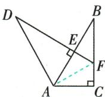

> [!success]- 必刷题
>
> > [!success] **【答案】** (1)
>
> > [!note]- **【解析】**
> > 【证明】∵ $\angle ACB = 90^{\circ}, DE \perp AB, \therefore \angle ACB = \angle AED = 90^{\circ}$ . 在 Rt $\triangle AED$ 和 Rt $\triangle ACB$ 中， $\left\{\begin{aligned}AD=AB,\\ AE=AC,\end{aligned}\right.$ $\therefore$ Rt $\triangle AED \cong$ Rt $\triangle ACB(HL),$ ∴ DE = BC.
> >
> > (2)【解】如图,连接AF.∵BF=2,CF=1,∴DE=BC=2+1=3.∵Rt△AED≌Rt△ACB,
> > ∴AE=AC. 在 Rt △AEF 和
> >
> > 
> >
> > Rt△ACF 中， $\left\{\begin{aligned}AF&=AF,\\ AE&=AC,\end{aligned}\right.$ ∴ Rt△AEF≌Rt△ACF
> > (HL)，∴ EF = CF = 1，∴ DF = DE + EF = 3 + 1 = 4.
