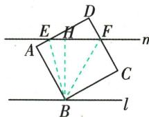

> [!success]- 必刷题
>
> > [!success] **【答案】** A
>
> > [!note]- **【解析】**
> > 如图, 过 B 作 $BH \perp m$ 于 H, 连接 BE, BF. ∵ 直线 l 向上平移线段 AB 的长得到直线 m,
> >
> > 
> >
> > $\therefore BH = AB.$ 又 $\because \angle A = \angle BHE = 90^{\circ}, EB = EB,$ $\therefore \mathrm{Rt}\triangle AEB\cong \mathrm{Rt}\triangle HEB,\therefore AE = EH.$ 同理得 $\mathrm{Rt}\triangle FCB\cong \mathrm{Rt}\triangle FHB,\therefore HF = CF,\therefore \triangle DEF$ 的周长为 $DE + EF + DF = DE + EH + HF + DF = DE+$ $AE + CF + DF = AD + CD = 2AB.\therefore$ 求 $\triangle DEF$ 的周长，只需知道 $AB$ 的长.
> >
> > 故选 **A**.
